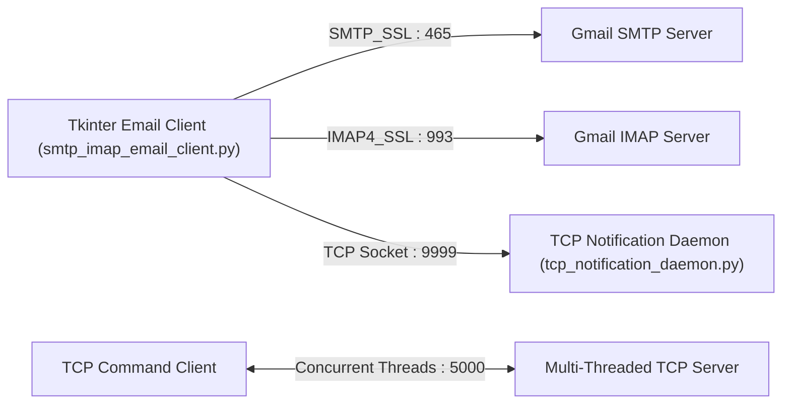

# 🌐 Secure SMTP/IMAP Email Client & Multi-Threaded TCP Socket Engine

A Computer Networking & Systems Programming repository featuring:
1. **Desktop SSL Email Client with Live TCP Socket Telemetry (`smtp_imap_email_client.py` & `tcp_notification_daemon.py`)**: Sends emails over `SMTP_SSL` (Port 465), fetches inbox messages over `IMAP4_SSL` (Port 993), measures round-trip protocol latency, triggers OS desktop notifications, and streams real-time status events to a local TCP socket listener (`127.0.0.1:9999`).
2. **Multi-Threaded Concurrent TCP Command Server (`multithreaded_tcp_server.py` & `tcp_command_client.py`)**: Concurrent `AF_INET` / `SOCK_STREAM` server spawning daemon threads per client connection with a custom application-layer text command protocol (`UPPER`, `LOWER`, `REVERSE`, `COUNT`, `VOWELS`, `TIME`, `DATE`, `QUIT`).
3. **Wireshark Packet Captures (`captures/`)**: Recorded `.pcapng` traces of SMTP/IMAP TLS handshakes and raw TCP socket frame exchanges.

---

## 🏗️ System Architecture



---

## 📂 Repository Structure

| File | Role |
| :--- | :--- |
| `smtp_imap_email_client.py` | GUI Email Client (`smtplib.SMTP_SSL`, `imaplib.IMAP4_SSL`, RFC822 MIME parsing, socket telemetry) |
| `tcp_notification_daemon.py` | Background TCP socket server listening on `127.0.0.1:9999` for real-time email event alerts |
| `multithreaded_tcp_server.py` | Multi-client concurrent TCP server (`threading.Thread`, custom command parser on port `5000`) |
| `tcp_command_client.py` | Interactive CLI socket client for communicating with `multithreaded_tcp_server.py` |
| `Network_Protocol_Analysis_Report.pdf` | Technical documentation and Wireshark packet trace analysis |
| `captures/smtp_sending_trace.pcapng` | Wireshark packet capture of outbound SMTP/TLS session |
| `captures/imap_receiving_trace.pcapng` | Wireshark packet capture of inbound IMAP/TLS session |

---

## 🚀 Usage

```bash
# Terminal 1: Start the TCP Notification Daemon
python tcp_notification_daemon.py

# Terminal 2: Launch the SMTP/IMAP GUI Client
python smtp_imap_email_client.py

# Or run the Multi-Threaded TCP Server & Client
python multithreaded_tcp_server.py
python tcp_command_client.py
```
